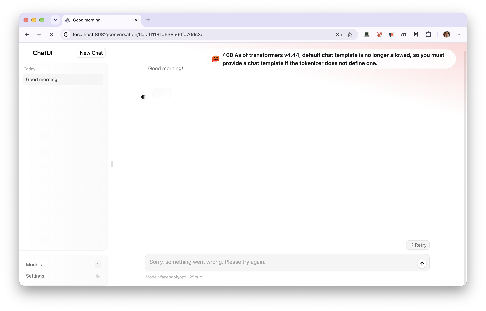
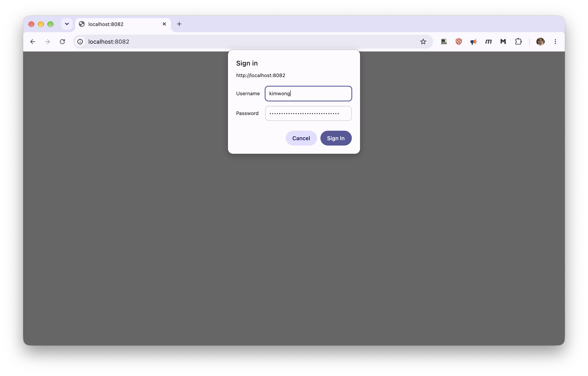
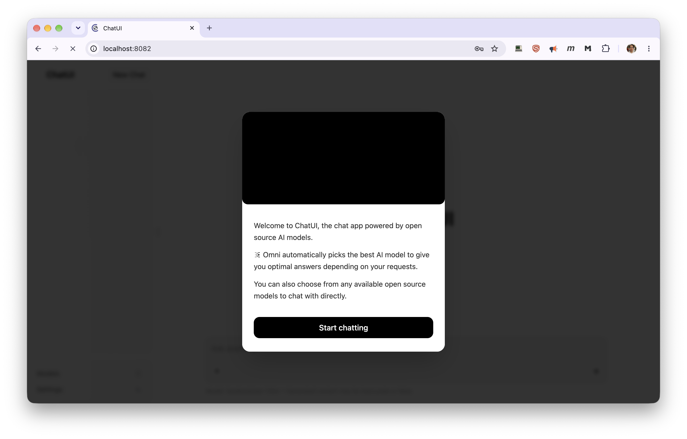
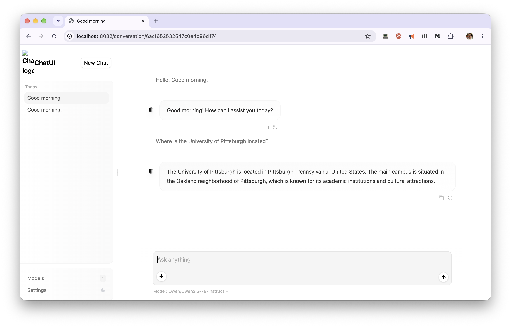
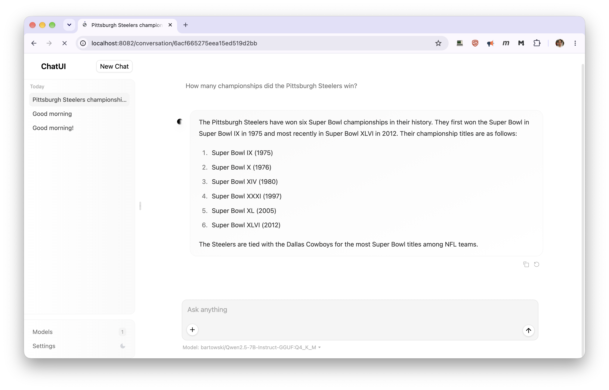

# Chat UI

The `chat-ui` module gives you a HuggingChat-style chat interface in your browser, talking to a model
running on your own GPU job through [vLLM](vllm-module.md) or [llama.cpp](llamacpp-module.md). Your
chats are saved and are still there the next time you start it, even on a different node.

Like [Open WebUI](open-webui.md), it sets up the server for you: load `chat-ui` and it loads the
backend, starts it, and connects the interface to it. Chat UI is the lighter of the two; Open WebUI
adds document upload, web search, and agent tools.

!!! warning "The login protects the interface, not the model"

    Chat UI asks for a password, so only you can use the chat interface. But the backend it starts
    is an ordinary vLLM or llama.cpp server with a placeholder API key, and ports are open within
    the CRCD environment. Anyone who finds the backend's host and port can query the model
    directly, bypassing the interface entirely — and bill your allocation. Stop the job when you are
    done. See [Keeping your endpoint private](inference-server.md).

## Quick start

```bash
srun -M gpu -p rtx6k -n1 -c16 --gres=gpu:1 -t 2:00:00 --pty bash

export CHATUI_BACKEND="vllm"                        # or "llamacpp" -- default is vllm
export VLLM_MODEL="Qwen/Qwen2.5-0.5B-Instruct"      # small, and able to chat
module load chat-ui
```

On the first start you'll see something like:

```
chat-ui starting -> http://gpu-n76.crc.pitt.edu:39417  (backend: vllm at http://gpu-n76:54667)
First start for this data directory: browser login 'kimwong' created, password saved to /xhome/crc/kimwong/.chat-ui/login-credentials (readable only by you).
chat-ui starts once the backend has loaded its model; run 'chat-ui-status' to check progress.
```

Later starts print `Browser login: 'kimwong' (password in ...)` in place of the second line. Wait
until both lines of the status report say `READY`:

```console
[kimwong@gpu-n76 ~]$ chat-ui-status
chat-ui:    READY    - http://gpu-n76.crc.pitt.edu:39417
Backend:    READY    - vllm at http://gpu-n76:54667 (models: Qwen/Qwen2.5-0.5B-Instruct, ...)
Login:      kimwong  (password in /xhome/crc/kimwong/.chat-ui/login-credentials)
```

!!! failure "Did not work: the vLLM backend's default model"

    Set `VLLM_MODEL`, even for a first test. With nothing set, the vLLM backend loads
    `facebook/opt-125m`, a base model with no chat template, and every message fails:

    

    ```
    400 As of transformers v4.44, default chat template is no longer allowed, so you must
    provide a chat template if the tokenizer does not define one.
    ```

    Any *instruct* or *chat* model works. `Qwen/Qwen2.5-0.5B-Instruct` is small enough to load in
    seconds.

Note `-n1 -c16`, not `-n16`: `-n16` gives an interactive shell, and everything started from it, a
single core while the job is billed for sixteen.

Chat UI waits for the backend to finish loading its model before it starts, so for a big model the
first few minutes of `chat-ui-status` say `waiting for the ... backend`. That's normal. If you open
the page during that time you'll see a short "still starting" message; reload it once
`chat-ui-status` says `READY`.

!!! warning "`chat-ui-status` doesn't notice a crashed backend"

    If the backend fails to start, `chat-ui-status` keeps reporting it as `STARTING` indefinitely.
    If the wait seems too long, ask the backend directly:

    ```console
    [kimwong@gpu-n78 ~]$ vllm-status
    vLLM process is not running - it may have crashed. Check the log below:
    ```

    The log's last lines name the cause. One you may meet is
    `Free memory on device ... is less than desired GPU memory utilization`, which means the GPU
    was already in use when the backend started — see the [vLLM](vllm-module.md) troubleshooting
    list.

## Opening it in your browser

The module prints a URL on the compute node, but **opening it directly won't work**: CRCD's clusters
are firewalled, so a browser on your laptop can't reach a compute node, even on the VPN. Forward the
port through a login node instead — **run this on your laptop**, using the node and port from the
printed URL:

```bash
ssh -N -L 8080:gpu-n76:23214 <pittID>@h2p.crc.pitt.edu
```

Then open `http://localhost:8080/`. Leave the `ssh` command running while you use it. You need to be
on Wireless-PittNet or the University VPN. See
[Your laptop (SSH tunnel)](inference-server.md) for what each part of the command does.

!!! tip "Use a different local port for each application"

    Your browser keeps cached pages, logins and background scripts per local port. If you have
    used `localhost:8080` for another server, it can show you that server's interface, or fail with
    an error mentioning `<!doctype`. Pick a fresh port — `8081`, `8082` — and check nothing is
    still holding it with `lsof -i :8080`.

Your browser asks for a username and password in its own sign-in prompt, rather than a page:



They're in your credentials file:

```bash
cat ~/.chat-ui/login-credentials
```

Your browser can remember them, though it may ask again next time. The same login works on later
jobs, on any node, as long as you use the same data directory.

The first time, Chat UI opens with a welcome screen. It describes HuggingChat's "Omni" model
routing, which doesn't apply here — your backend serves one model. Choose **Start chatting**:



Then chat as you would anywhere else — here with the vLLM backend serving
`Qwen/Qwen2.5-7B-Instruct`:



## Picking a model

The model is chosen by the backend module, using its own variables. Set them before loading:

```bash
# vLLM backend
export CHATUI_BACKEND="vllm"
export VLLM_MODEL="Qwen/Qwen2.5-7B-Instruct"
export VLLM_DOWNLOAD_DIR="/vast/<group>/$USER/vllm"

# or llama.cpp backend
export CHATUI_BACKEND="llamacpp"
export LLAMACPP_MODEL="bartowski/Qwen2.5-7B-Instruct-GGUF:Q4_K_M"
export LLAMACPP_DOWNLOAD_DIR="/vast/<group>/$USER/llamacpp"

module load chat-ui
```

Always set a model. The vLLM backend's default, `facebook/opt-125m`, has no chat template and can't
chat at all; see the warning in the quick start. Every option on the [vLLM](vllm-module.md) and [llama.cpp](llamacpp-module.md)
pages still applies, including the `~/.cache/huggingface` directory the vLLM backend needs on first
use.

You can switch backends between jobs, or within one by reloading the module. Your conversations
stay, since they live in the data directory rather than with the backend — here the sidebar still
holds the chats from the vLLM session above, now answered by llama.cpp:



## Where your data lives

Everything — chat history, the login file, your settings file — is in:

```
~/.chat-ui/
```

To keep it somewhere else, set this before loading, and keep using the same value in future jobs:

```bash
export CHATUI_DATA_DIR="/path/to/your/project/chat-ui"
```

Chat history is stored in a MongoDB database inside that directory. If you move it and
`chat-ui-status` reports `DOWN` with a mention of MongoDB, the new filesystem is one MongoDB has
trouble with; move it back.

Only **one** Chat UI server can use a data directory at a time. A second job started against the
same directory refuses to start and tells you which job holds it.

## Changing your login

Edit the `username=` and `password=` lines in `~/.chat-ui/login-credentials`; the change applies the
next time you load the module.

!!! warning "Don't change the `email=` line"

    It's the internal account your chats are stored under. Changing it makes your past chats
    disappear from view.

To choose the login before your very first start instead:

```bash
export CHATUI_LOGIN_USER="me"
export CHATUI_LOGIN_PASSWORD="something-long"
```

## Changing Chat UI settings

Put Chat UI settings in a file in your data directory, one `KEY=VALUE` per line, using the variable
names from [Chat UI's `.env` file](https://github.com/huggingface/chat-ui/blob/main/.env). Quote any
value containing spaces or JSON with single quotes:

```bash
cat > ~/.chat-ui/chat-ui.env <<'EOF'
PUBLIC_APP_NAME="My Cluster Chat"
LLM_SUMMARIZATION=false
MODELS='[{"id":"Qwen/Qwen2.5-7B-Instruct","name":"Qwen 2.5 7B","parameters":{"temperature":0.7}}]'
EOF
```

It's picked up on the next `module load`. To use a file elsewhere, set `CHATUI_ENV_FILE`.

`MODELS` only overrides how models are shown and prompted; the list of models itself always comes
from your backend. Each entry's `id` must match a model name the backend serves — `chat-ui-status`
lists them. The supported override fields are in
[Chat UI's configuration documentation](https://huggingface.co/docs/chat-ui/en/configuration/overview).
The backend connection, the database, and the login are always controlled by the module.

## Configuration

Set these before `module load chat-ui`.

| Variable | Purpose | Default |
| --- | --- | --- |
| `CHATUI_BACKEND` | `vllm` or `llamacpp` | `vllm` |
| `CHATUI_DATA_DIR` | Where chats, the login file and settings are kept | `~/.chat-ui` |
| `CHATUI_LOGIN_USER` | Browser login username, first start only | `$USER` |
| `CHATUI_LOGIN_PASSWORD` | Browser login password, first start only | random, saved to `login-credentials` |
| `CHATUI_ENV_FILE` | Extra Chat UI settings file | `<data dir>/chat-ui.env`, if present |
| `CHATUI_PUBLIC_HOST` | Hostname shown in the printed URL | the node's full hostname |
| `CHATUI_BACKEND_API_KEY` | API key sent to the backend | placeholder `local-vllm` / `local-llamacpp` |
| `CHATUI_EXCLUDE_PORTS` | Extra ports to avoid, space separated | none |

The module also accepts `CHATUI_IMAGE`, `CHATUI_CONTAINER_RUNTIME`, `CHATUI_CONTAINER_BINDS`,
`CHATUI_CONTAINER_ARGS` and `CHATUI_CONTAINER_WRITABLE_FLAG` for working around container problems;
you are unlikely to need them.

## Checking and stopping

```bash
chat-ui-status          # readiness, startup progress, URL, login
chat-ui-stop            # stop the interface only; the backend keeps running
module unload chat-ui   # stop the interface, and the backend if chat-ui started it
```

```console
[kimwong@gpu-n76 ~]$ chat-ui-stop
Stopped chat-ui server (PID 2014890).
[kimwong@gpu-n76 ~]$ module unload chat-ui
vLLM server stopped.
chat-ui server stopped.
```

The backend's own tools work too: `vllm-status` / `vllm-stop`, or `llamacpp-status` /
`llamacpp-stop`. Everything stops when your SLURM job ends; your chats are already saved.

## Troubleshooting

| Symptom | Cause | What to do |
| --- | --- | --- |
| `CHATUI_BACKEND must be 'vllm' or 'llamacpp'` | Typo, or a leftover value | `unset CHATUI_BACKEND` |
| `The vllm/llamacpp backend did not report a base URL` | The backend failed to start | Scroll up for its own error, usually the SLURM or GPU check |
| `... is in use by chat-ui in SLURM job NNN` | Another of your jobs uses the same data directory | `scancel -M gpu NNN`, or set a different `CHATUI_DATA_DIR` |
| `400 As of transformers v4.44, default chat template is no longer allowed` | The model has no chat template — usually the vLLM default, `facebook/opt-125m` | Set `VLLM_MODEL` to an instruct model and reload the module |
| Stuck on `waiting for the ... backend` | The model is still loading — or the backend has crashed, which `chat-ui-status` does not detect | Run `vllm-status` / `llamacpp-status`. If it says the process is not running, read the log it prints, fix the cause, and reload the module |
| The browser keeps asking for the password | It doesn't match `login-credentials` | If you edited that file, `module unload chat-ui && module load chat-ui` |
| `chat-ui is not reachable yet (still starting?)` | Still starting | Wait for `READY` and reload the page |
| The browser can't connect | Opening the printed URL directly, the tunnel isn't running, or the interface is still starting | Use the SSH tunnel and `localhost`; check the `ssh -L` is still running; wait for `READY` |
| Past chats are gone | Different data directory, or the `email=` line changed | Use the same `CHATUI_DATA_DIR`, and restore the original `email=` |
| `DOWN`, mentioning MongoDB | The data directory's filesystem doesn't suit MongoDB | Check the `mongod.log` path `chat-ui-status` prints; move the directory with `CHATUI_DATA_DIR` |
| A `WARNING ... internal port` line in `chat-ui-status` | Your Chat UI is reachable **without** the login | Stop it with `chat-ui-stop` and contact CRCD |
| Anything else | | The full server log is at `$CHATUI_LOGFILE` |

## Related

<div class="grid cards" markdown>

-   :material-chat-processing: **A fuller chat interface**

    ---

    Document upload, web search, and agent tools.

    [Open WebUI](open-webui.md)

-   :material-server-network: **The serving workflow**

    ---

    Hardware sizing, access routes, and costs.

    [Inference Servers](inference-server.md)

-   :material-speedometer: **The vLLM backend**

    ---

    Every `VLLM_*` variable, including extra arguments.

    [vLLM](vllm-module.md)

-   :material-file-code: **The llama.cpp backend**

    ---

    Quantized GGUF models, context size, and concurrency.

    [llama.cpp](llamacpp-module.md)

</div>
