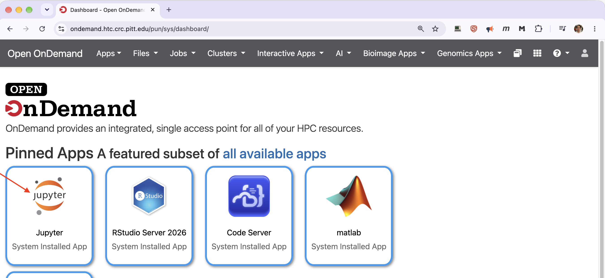
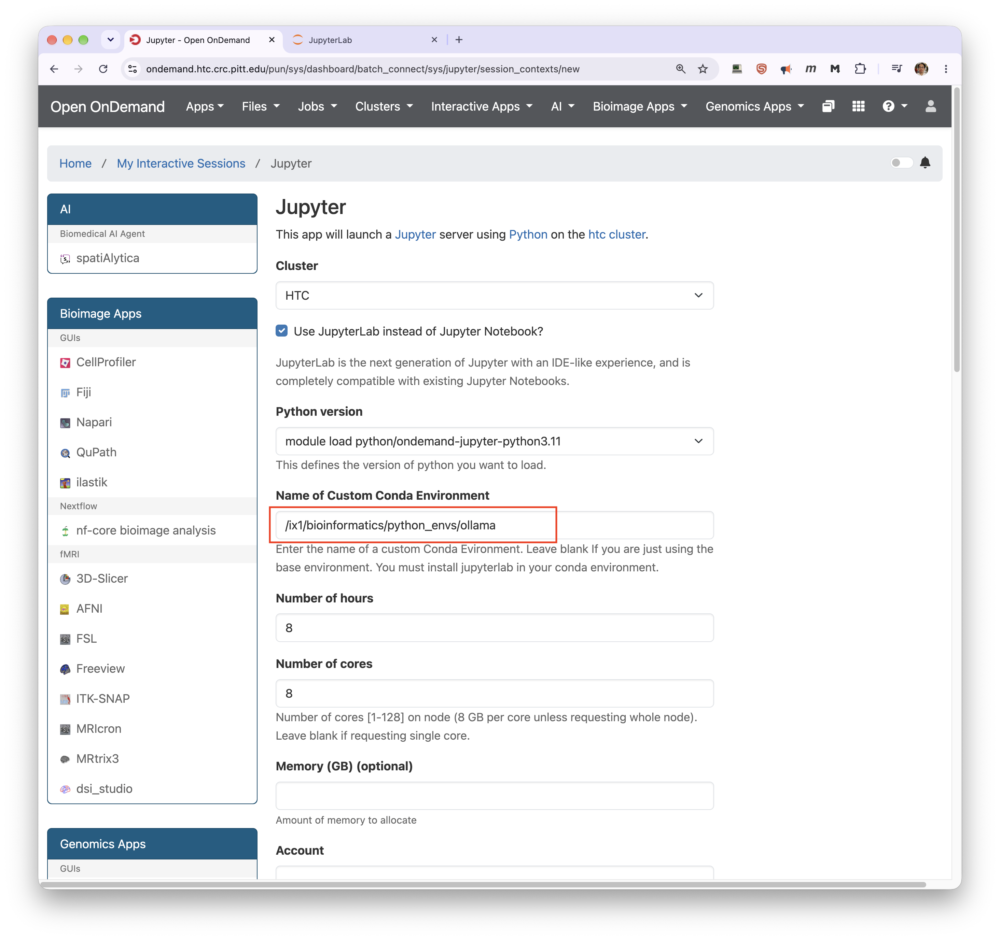
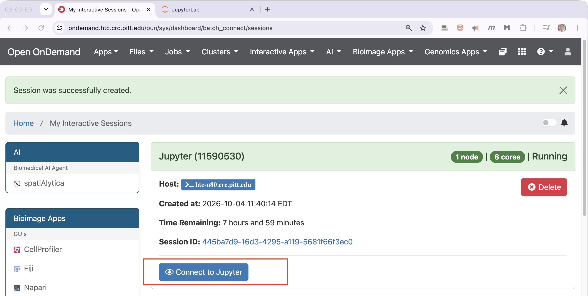
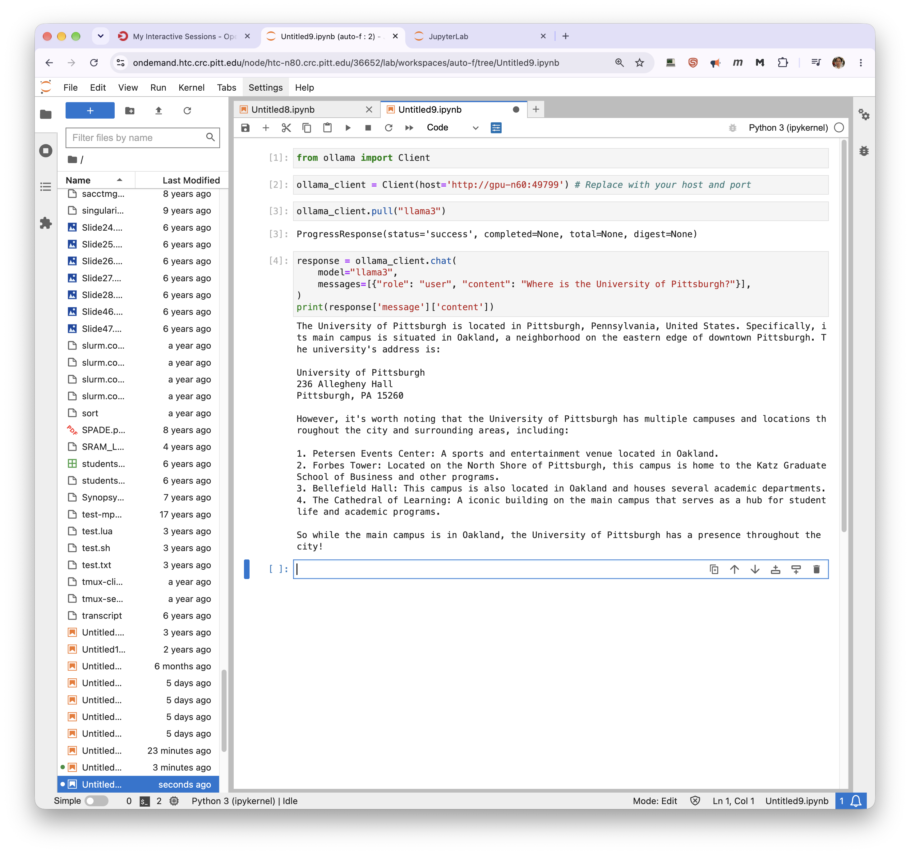
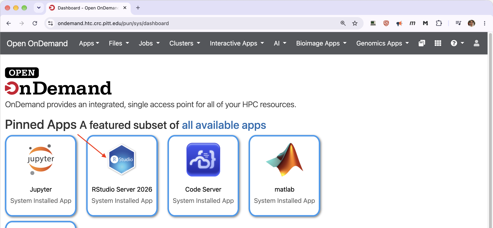
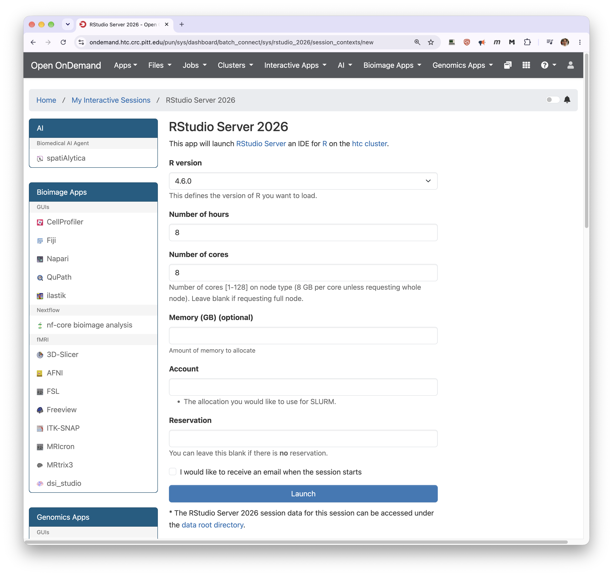
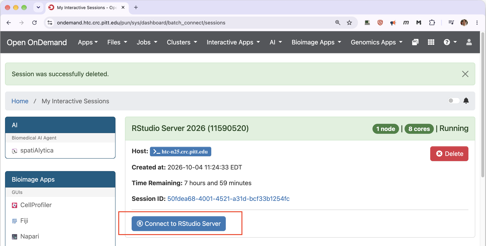
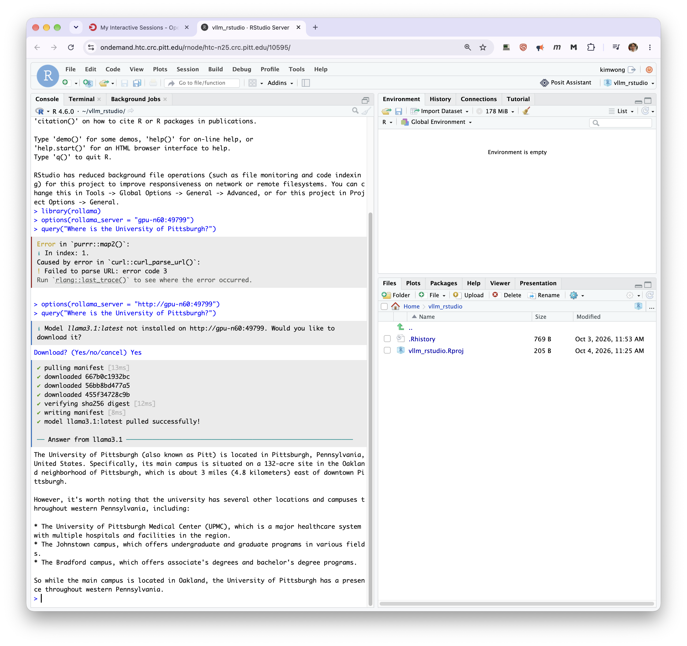

# Ollama

Ollama runs large language models behind an HTTP API, and is the easiest of the CRCD serving
options for pulling community models by name. Loading the `ollama` module starts an Ollama server
for your job and gives you the usual `ollama` command to use with it.

This page covers what is specific to Ollama. For choosing hardware, reaching a server from elsewhere
on the cluster, service-unit costs, and the other access routes, see
[Inference Servers on the GPU Cluster](inference-server.md).

!!! warning "Ollama has no authentication"

    Ports are open within the CRCD environment, so anyone who finds your server's host and port can
    send it requests — and can also **add or delete models in your `OLLAMA_MODELS` directory**. A
    single `curl` from a login node, with no credentials, removed a model from a running server:

    ```bash
    curl -X DELETE "http://gpu-n76:28324/api/delete" -d '{"model":"qwen3:0.6b"}'
    ```

    Keep these jobs short, stop the server when you are done, and use [vLLM](vllm-module.md) with
    an API key for anything long-lived or sensitive.

## Quick start

You need an interactive or batch job with a GPU. Loading the module on a login node, or in a job
with no GPU, fails with a clear error rather than starting anything.

```bash
srun -M gpu -p rtx6k -n1 -c16 --gres=gpu:1 -t 2:00:00 --pty bash

export OLLAMA_MODELS="/vast/<group>/$USER/ollama-models"
module load ollama/0.40.3
```

```
Ollama (container) started - run 'ollama-status' to check readiness.
Base URL: http://gpu-n76:28324
GPU: 1 x NVIDIA RTX PRO 6000 Blackwell Server Edition [ollama,cuda_v13]
CPU threads per model: 16 (this job's usable CPUs)
```

Note `-n1 -c16`, not `-n16`; see [CPU cores](#cpu-cores) below.

Then use Ollama the way you would on your own machine:

```bash
ollama pull qwen3:8b
ollama run qwen3:8b
ollama list      # models you have downloaded
ollama ps        # models in GPU memory right now
```

The `ollama` command here is a wrapper that talks to your job's server. You don't start the server
yourself — the module already did, and `ollama serve` says so:

```
This job's Ollama server is already running at gpu-n76:28919 (module load started it).
Use 'ollama-status' to check it, or 'module unload ollama' to stop it.
```

The module loads its own container runtime, so there is nothing else to load first.

## CPU cores

The module sets the server's CPU thread count from your allocation, and reports it in the banner
and in `ollama-status`. With a model fully on the GPU, `qwen3:8b` generates about **215 tokens per
second** on an RTX PRO 6000.

**Request cores with `-n1 -c16`.** `-n16` asks for sixteen tasks of one CPU each, and an interactive
shell runs as just one of them — so the server you start from it can use a single core while the
job is billed for sixteen. Check with `nproc`, which should print 16.

!!! tip "Slow responses, GPU idle?"

    If generation is slow while `ollama ps` says `100% GPU`, watch `nvidia-smi` during a request. A
    GPU near 0% utilization means the bottleneck is on the CPU side: check that `ollama-status`
    reports the thread count you expect, and that `nproc` matches your request. If you are using a
    reasoning model, the wait may also be thinking tokens — see below.

## Keep your models: set `OLLAMA_MODELS`

Without `OLLAMA_MODELS`, downloaded models go to a scratch directory that disappears with your
job, so every job downloads them again. Point it at your group's storage once and reuse it — models
pulled in one job are there in the next:

```console
[kimwong@gpu-n76 ~]$ ollama list
NAME                                                      ID              SIZE      MODIFIED
hf.co/bartowski/Qwen2.5-Coder-32B-Instruct-GGUF:Q4_K_M    46b772a6e281    19 GB     19 minutes ago
qwen3:8b                                                  500a1f067a9f    5.2 GB    37 minutes ago
```

Avoid your home directory, which has a 75 GB quota. Several of your jobs can share one
`OLLAMA_MODELS` directory; avoid pulling the *same* model from two jobs at the same moment.

## Models from Hugging Face

Ollama can pull GGUF models straight from Hugging Face:

```bash
ollama pull hf.co/bartowski/Qwen2.5-Coder-32B-Instruct-GGUF:Q4_K_M
ollama run hf.co/bartowski/Qwen2.5-Coder-32B-Instruct-GGUF:Q4_K_M
```

## Checking on the server

```bash
ollama-status
```

```
READY - http://gpu-n76:28324
  Version:        0.40.3
  GPU:            1 x NVIDIA RTX PRO 6000 Blackwell Server Edition
  Models on disk: 4  (ollama list)
  Loaded now:     qwen3:8b  (ollama ps shows the GPU/CPU split)
  CPU threads:    16 per model
  Preload:
    qwen3:8b                                 ready
    nomic-embed-text                         pulled  loads on first request ("nomic-embed-text" does not support generate)
```

Its exit code tells a script where things stand:

| State | Exit code | Meaning |
| --- | --- | --- |
| `READY` | 0 | Server up, preloaded models ready |
| `PRELOADING` | 2 | Server up, preload still downloading or loading — keep waiting |
| `PRELOAD FAILED` | 1 | Server up, but a preload model failed, usually a typo in its name |
| `DOWN` | 1 | Server not running; the output shows the log path and its last lines |

`module load` returns only once the server is up, so a script sees `PRELOADING` or `READY` rather
than `STARTING`. Without `OLLAMA_PRELOAD`, `ollama-status` reports `READY` straight away.

Embedding models such as `nomic-embed-text` show as `pulled` rather than `ready`, since they load on
their first request. That does not hold up `READY`.

`ollama ps` shows, for each loaded model, how much of it is on the GPU:

```
NAME        ID              SIZE     PROCESSOR    CONTEXT    RUNNER      UNTIL
qwen3:8b    500a1f067a9f    11 GB    100% GPU     40960      llamacpp    4 minutes from now
```

`100% GPU` is what you want. Anything mentioning CPU means the model doesn't fit and will be much
slower: use a smaller model or quantization, a shorter context, or more GPUs.

Expect a model to occupy noticeably more GPU memory than its download size, because the context
window's cache sits alongside the weights. Here `qwen3:8b` is 5.2 GB on disk and 11 GB loaded; the
19 GB Qwen2.5-Coder model takes 28 GB.

## Batch jobs

Set `OLLAMA_PRELOAD` to the models a script will use. The module downloads them and loads them onto
the GPU in the background, and the exit codes above tell the script when it can start:

```bash
#!/bin/bash
#SBATCH -M gpu
#SBATCH -p rtx6k
#SBATCH --ntasks=1
#SBATCH --cpus-per-task=16
#SBATCH --gres=gpu:1
#SBATCH -t 2:00:00

export OLLAMA_MODELS="/vast/<group>/$USER/ollama-models"
export OLLAMA_PRELOAD="qwen3:8b nomic-embed-text"
module load ollama/0.40.3

# wait until ready (exit 0); stop if something failed (exit 1)
until ollama-status > /dev/null; do
    [ $? -eq 1 ] && { ollama-status; exit 1; }
    sleep 10
done

python my_script.py
```

A crashed server returns exit code 1 rather than the "keep waiting" code, so a failure ends the job
instead of leaving it to run — and bill — until its walltime. Ready-to-submit server templates, one
per GPU partition, are installed under `/software/rhel9/manual/install/inference-templates/ollama/`.

## Sending requests from your own code

The module sets `$OLLAMA_HOST` and `$OLLAMA_BASE_URL` in your shell:

```console
[kimwong@gpu-n74 ~]$ echo $OLLAMA_BASE_URL
http://gpu-n74:32748
```

Both APIs work from anywhere in the CRCD environment. Ollama's own API:

```bash
curl "$OLLAMA_BASE_URL/api/chat" -d '{
  "model": "qwen3:8b",
  "messages": [{"role": "user", "content": "Hello!"}],
  "stream": false
}'
```

The OpenAI-compatible API — most OpenAI client libraries work by pointing `base_url` at
`$OLLAMA_BASE_URL/v1` with any placeholder API key:

```bash
curl "$OLLAMA_BASE_URL/v1/chat/completions" \
  -H "Content-Type: application/json" \
  -d '{"model": "qwen3:8b",
       "messages": [{"role": "user", "content": "Hello!"}]}'
```

!!! note "These variables exist only in the server's shell"

    A Jupyter notebook, an R session, or a job on another node does not inherit `$OLLAMA_BASE_URL`.
    Copy the address from the module's output or from `ollama-status`, and use it directly.

### Reasoning models think out loud

Models such as `qwen3` reason before answering. `ollama run` prints this as a `Thinking...` block,
and the APIs return it in a separate field — `thinking` from `/api/chat`, `reasoning` from
`/v1/chat/completions` — alongside the answer in `content`. Client code can ignore the extra field.

The reasoning can be long — one simple factual question produced 1,425 tokens of deliberation before
the answer. That looks like slowness but isn't. If you don't need it, switch it off:

```bash
ollama run qwen3:8b "Hello" --think=false
```

For Ollama's own API, the module's documentation gives `"think": false` in the request.

## Connecting from Jupyter

Your notebook needs the server's address — copy it from `ollama-status` in the server's session.
The screenshots below show an earlier server's address; substitute your own.

=== "1. Launch Jupyter"

    From the OnDemand dashboard at [ondemand.htc.crc.pitt.edu](https://ondemand.htc.crc.pitt.edu),
    open **Jupyter**. An HTC session is the right choice: the GPU work happens in your Ollama job.

    

=== "2. Choose the environment"

    CRCD provides a conda environment with the `ollama` Python package already installed. Enter it
    in **Name of Custom Conda Environment**:

    ```
    /ix1/bioinformatics/python_envs/ollama
    ```

    

=== "3. Connect"

    

=== "4. Query the server"

    

    ```python
    from ollama import Client

    ollama_client = Client(host='http://gpu-n74:32748')   # your server's address
    ollama_client.pull("llama3")

    response = ollama_client.chat(
        model="llama3",
        messages=[{"role": "user", "content": "Where is the University of Pittsburgh?"}],
    )
    print(response['message']['content'])
    ```

??? note "Building your own environment instead"

    If you would rather not use the shared environment:

    ```bash
    module load python/ondemand-jupyter-python3.11
    conda create --prefix=/ix1/<group>/python_envs/ollama python=3.11
    source activate /ix1/<group>/python_envs/ollama
    pip install ollama jupyterlab
    ```

    JupyterLab must be installed in the environment for OnDemand to use it as a custom conda
    environment.

## Connecting from RStudio

=== "1. Launch RStudio"

    Open **RStudio Server 2026** from the OnDemand dashboard.

    

=== "2. Pick a version"

    

=== "3. Connect"

    

=== "4. Query the server"

    

    ```r
    library(rollama)
    options(rollama_server = "http://gpu-n74:32748")   # your server's address
    query("Where is the University of Pittsburgh?")
    ```

    If the model is not on the server yet, `rollama` offers to download it and then answers.

!!! failure "Did not work: a server address without `http://`"

    `rollama` needs the scheme. Without it:

    ```r
    > options(rollama_server = "gpu-n60:49799")
    > query("Where is the University of Pittsburgh?")
    Error in `purrr::map2()`:
    i In index: 1.
    Caused by error in `curl::curl_parse_url()`:
    ! Failed to parse URL: error code 3
    ```

    Add the prefix and it works. The Python client is the same.

## Shutting down

```bash
ollama-stop          # stop the server, keep the module loaded
```

```
Stopped Ollama server (PID 3247067).
```

`module unload ollama` and `module purge` also stop it, and ending the job does too. Your models
stay in `OLLAMA_MODELS`.

Loading the module again stops the running server and starts a fresh one, which is how to pick up
changed settings such as a new `OLLAMA_PRELOAD`.

If you run `ollama-stop` and then unload, the unload prints `No pidfile ...; nothing to stop.`
That is informational — the server was already stopped.

!!! tip "Copy the log before the job ends"

    The server log is in job scratch, for example
    `/scratch/slurm-4377379/ollama-kimwong-4377379/server.log`, and is deleted with the job. If you
    need it for a help ticket, copy it out first:

    ```bash
    cp "$OLLAMA_LOGFILE" ~/ollama-server-$SLURM_JOB_ID.log
    ```

## Further options

The following come from the module's own documentation and have not yet been verified on CRCD.

**A GGUF file you already have.** Create a model from it with a one-line Modelfile:

```bash
echo "FROM /vast/<group>/$USER/models/my-model.Q4_K_M.gguf" > Modelfile
ollama create my-model -f Modelfile
```

Files under your home and current directories are visible automatically; for anything else, set
`OLLAMA_CONTAINER_BINDS` to its location before loading the module.

**Server settings.** Ollama's own environment variables are read at load time:

```bash
export OLLAMA_CONTEXT_LENGTH=32768   # longer context window, more GPU memory
export OLLAMA_KEEP_ALIVE=-1          # keep models loaded instead of unloading after 5 idle minutes
export OLLAMA_FLASH_ATTENTION=1
export OLLAMA_KV_CACHE_TYPE=q8_0     # smaller KV cache, fits longer contexts
export OLLAMA_NUM_PARALLEL=4         # serve several requests at once per model
module load ollama/0.40.3
```

**Multiple GPUs.** Request more GPUs and Ollama uses them; a model that fits on one stays on one.

**Tool calling** works for models whose page on ollama.com lists "tools", with nothing extra to
enable.

## Troubleshooting

| Symptom | Likely cause | What to do |
| ------- | ------------ | ---------- |
| Very slow responses, GPU near idle in `nvidia-smi` | Session pinned to fewer cores than expected, or a reasoning model thinking | Check `nproc` and the thread count in `ollama-status`; request `-n1 -c16`; try `--think=false` |
| `must be loaded inside a SLURM job` | You are on a login node | Start an interactive session or a batch job first |
| `No GPU is visible to this job` | No GPU attached to the allocation | Add `--gres=gpu:1` |
| `Ollama started but found no usable GPU` | Node or driver issue | Contact CRCD with the message |
| `Failed to parse URL: error code 3` | Server address is missing `http://` | Add the scheme |
| `ollama` says it can't connect | The server stopped | Run `ollama-status`, then reload the module |
| Batch job exits immediately with `PRELOAD FAILED` | A model name in `OLLAMA_PRELOAD` is wrong | Check the name against ollama.com or `ollama list` |
| Models download again every job | `OLLAMA_MODELS` not set | Point it at your group's storage before loading |
| Anything else | | The full log is at `$OLLAMA_LOGFILE` — copy it before the job ends |

If you are stuck, submit a [help ticket](https://services.pitt.edu/TDClient/33/Portal/Requests/TicketRequests/NewForm?ID=yXkHi62rHa8_&RequestorType=Service)
with your job ID and a copy of the server log.

## Related

<div class="grid cards" markdown>

-   :material-server-network: **The general workflow**

    ---

    Hardware sizing, access routes, costs, and the other serving options.

    [Inference Servers](inference-server.md)

-   :material-speedometer: **Higher throughput**

    ---

    vLLM serves many clients at once and supports an API key.

    [vLLM](vllm-module.md)

-   :material-file-code: **Quantized models with a chat UI**

    ---

    llama.cpp serves GGUF models and a browser chat interface.

    [llama.cpp](llamacpp-module.md)

-   :material-cash: **What a job costs**

    ---

    GPU jobs are billed per card for their full walltime.

    [Service Units](../../slurm/service-units.md)

</div>
