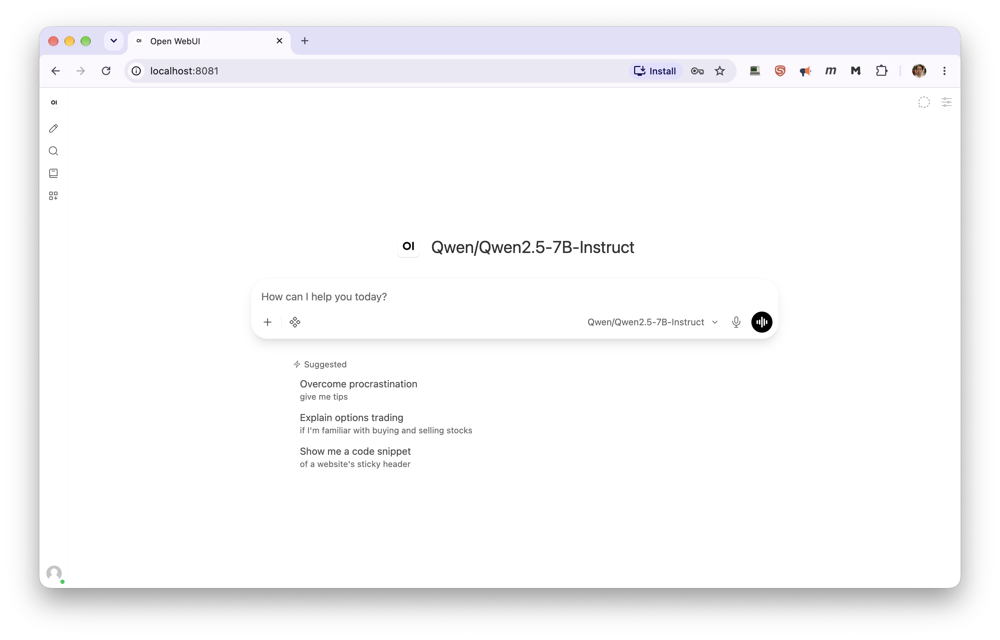
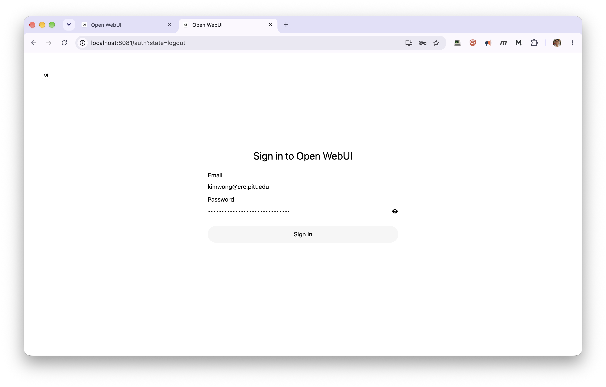
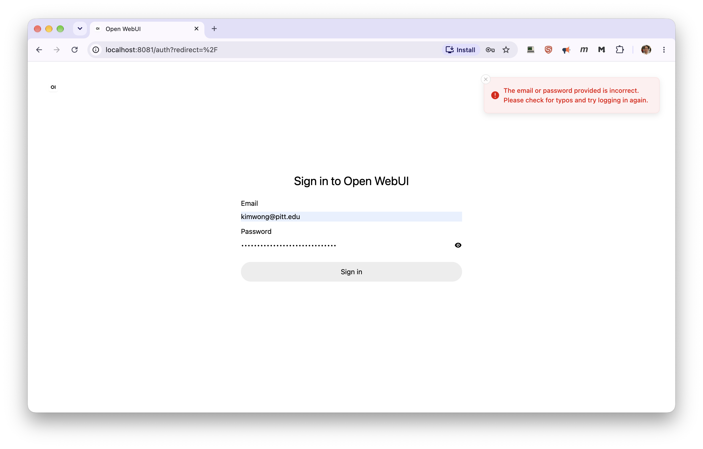
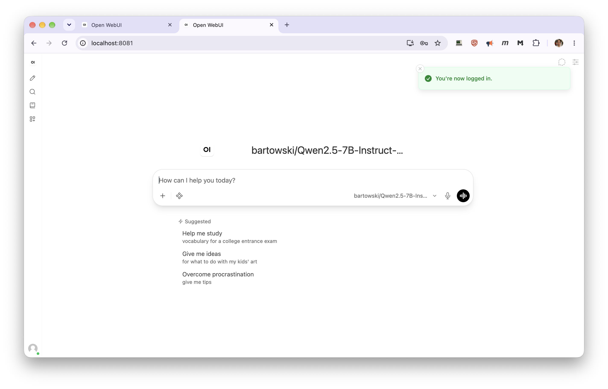
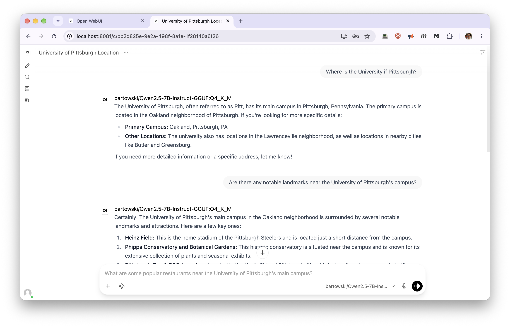

# Open WebUI

The `open-webui` module gives you a ChatGPT-style chat interface in your browser, talking to a
model running on your own GPU job through [vLLM](vllm-module.md) or [llama.cpp](llamacpp-module.md).
Your chats are saved and are still there the next time you start it.

Like [Claude Code](claude-code.md), it sets up the server for you: load `open-webui` and it loads
the backend, starts it, and connects the interface to it.

!!! warning "The login protects the interface, not the model"

    Open WebUI has a login, and account creation is turned off, so only you can use the chat
    interface. But the backend it starts is an ordinary vLLM or llama.cpp server with a placeholder
    API key, and ports are open within the CRCD environment. Anyone who finds the backend's host and
    port can query the model directly, bypassing the interface entirely — and bill your allocation.
    From a login node, with no credentials:

    ```console
    [kimwong@login2 ~]$ curl http://gpu-n76:26204/v1/models
    {"models":[{"name":"bartowski/Meta-Llama-3.1-8B-Instruct-GGUF:Q4_K_M", ...
    ```

    The backend's address is printed when the module loads. Stop the job when you are done. See
    [Keeping your endpoint private](inference-server.md).

## Quick start

```bash
srun -M gpu -p rtx6k -n1 -c16 --gres=gpu:1 -t 2:00:00 --pty bash

export OPENWEBUI_BACKEND="vllm"                    # or "llamacpp" -- default is vllm
export VLLM_MODEL="unsloth/Llama-3.2-1B-Instruct"     # set one: the vLLM default can't chat
module load open-webui
```

On the first start you'll see something like:

```
Open WebUI starting -> http://gpu-n76.crc.pitt.edu:30097  (backend: vllm at http://gpu-n76:55831)
First start for this data directory: admin login 'kimwong@crc.pitt.edu' created, password saved to /xhome/crc/kimwong/.open-webui/admin-credentials (readable only by you).
Startup takes ~30-60s; run 'open-webui-status' to check. The model list fills in once the backend finishes loading - refresh the page if it's empty.
```

Later starts print `Log in as '...'` in place of the second line.

Wait until both lines of the status report say `READY`:

```console
[kimwong@gpu-n76 ~]$ open-webui-status
Open WebUI: READY    - http://gpu-n76.crc.pitt.edu:38805
Backend:    READY    - vllm at http://gpu-n76:42807 (models: unsloth/Llama-3.1-8B-Instruct, ...)
Login:      kimwong@crc.pitt.edu  (password in /xhome/crc/kimwong/.open-webui/admin-credentials)
```

The interface is ready within a minute; the backend takes longer, especially the first time a model
downloads. Until it says `READY`, the interface loads but its model list is empty.

Note `-n1 -c16`, not `-n16`: `-n16` gives an interactive shell, and everything started from it, a
single core while the job is billed for sixteen.

## Opening it in your browser

The module prints a URL on the compute node, but **opening it directly won't work**: CRCD's clusters
are firewalled, so a browser on your laptop can't reach a compute node, even on the VPN. Forward the
port through a login node instead — **run this on your laptop**, using the node and port from the
printed URL:

```bash
ssh -N -L 8080:gpu-n76:23456 <pittID>@h2p.crc.pitt.edu
```

Then open `http://localhost:8080/`. Leave the `ssh` command running while you use it. You need to be
on Wireless-PittNet or the University VPN. See
[Your laptop (SSH tunnel)](inference-server.md) for what each part of the command does.



!!! tip "Use a different local port for each application"

    Your browser keeps cached pages, logins and background scripts per local port. If you have
    used `localhost:8080` for a *different* application, it can show you that application's
    interface, or fail with an error mentioning `<!doctype`. Pick a fresh port — `8081`, `8082` —
    and check nothing is still holding it with `lsof -i :8080`. Reusing a port for Open WebUI again
    later is fine.

## Logging in

The first time you use the module, a login is created for you:

```bash
cat ~/.open-webui/admin-credentials
```

That same login works every time after that, because it's stored in your data directory along with
your chats. Nobody else can sign up on your server. Restarting the server signs your browser out —
you'll land on the sign-in page — but the account is unchanged:



To choose the login yourself, set these **before your very first** `module load open-webui` — they
are ignored once the account exists:

```bash
export OPENWEBUI_ADMIN_EMAIL="you@pitt.edu"
export OPENWEBUI_ADMIN_PASSWORD="something-long"
```

If you later change your password inside the web interface, `admin-credentials` is **not**
updated, so remember the new one.

!!! failure "Did not work: editing `admin-credentials`"

    The file is a record of the login the module created, not a setting. The account itself lives
    in Open WebUI's database. Changing the email in the file changes nothing about the account —
    yet the module repeats the edited value back to you at startup and in `open-webui-status`, so
    the wrong email looks correct:

    

    Leave the file as the module wrote it. To use a different email, set `OPENWEBUI_ADMIN_EMAIL`
    before a first start — see "Forgot your password" under Troubleshooting for how to start
    fresh.

## Picking a model

The model is chosen by the backend module, using its own variables. Set them before loading:

```bash
# vLLM backend
export OPENWEBUI_BACKEND="vllm"
export VLLM_MODEL="unsloth/Llama-3.1-8B-Instruct"
export VLLM_DOWNLOAD_DIR="/vast/<group>/$USER/vllm"

# or llama.cpp backend
export OPENWEBUI_BACKEND="llamacpp"
export LLAMACPP_MODEL="bartowski/Meta-Llama-3.1-8B-Instruct-GGUF:Q4_K_M"
export LLAMACPP_DOWNLOAD_DIR="/vast/<group>/$USER/llamacpp"

module load open-webui
```

Always set a model. The vLLM backend's default, `facebook/opt-125m`, is a base model with no chat
template, so every message to it fails with `400 ... default chat template is no longer allowed`.
Any *instruct* or *chat* model works. Every option on the [vLLM](vllm-module.md) and [llama.cpp](llamacpp-module.md)
pages still applies, including the `~/.cache/huggingface` directory the vLLM backend needs on first
use.

Open WebUI shows whatever model the backend serves. If the model dropdown is empty, the backend is
probably still loading: wait for `Backend: READY` in `open-webui-status` and refresh the page.



Once a model is listed, chat as you would anywhere else. Open WebUI titles each conversation from
its first exchange and suggests follow-up questions:



## Where your data lives

Everything — accounts, chats, uploaded files, the settings file — is in:

```
~/.open-webui/
```

To keep it somewhere else, set this before loading, and keep using the same value in future jobs:

```bash
export OPENWEBUI_DATA_DIR="/path/to/your/project/open-webui"
```

Uploaded files count against wherever this lives, and your home directory has a 75 GB quota. If you
move it, check the next start for a `database is locked` error: the data directory needs a
filesystem with proper file locking.

Only **one** Open WebUI server can use a data directory at a time. A second job started against the
same directory refuses to start and tells you which job holds it.

## Changing Open WebUI settings

Settings you change in the **Admin Panel** last only until the server stops. The module has to do
this, because the backend's address changes every job. Your chats, uploads, workspace models and
prompts, and personal preferences *are* kept.

To make admin settings stick, put them in a settings file in your data directory, one `KEY=VALUE`
per line, using [Open WebUI's environment variable names](https://docs.openwebui.com/reference/env-configuration):

```bash
cat > ~/.open-webui/open-webui.env <<'EOF'
WEBUI_NAME="My Cluster Chat"
ENABLE_TITLE_GENERATION=False
DEFAULT_MODEL_PARAMS={"temperature":0.7}
EOF
```

It's picked up on the next `module load`. To use a file elsewhere, set `OPENWEBUI_ENV_FILE`. The
backend connection, the port, the data location, and sign-up being off are always controlled by the
module and can't be overridden.

## Tool calling (built-in tools)

By default the module runs Open WebUI's tool calling in **Legacy** mode. Chat, web search and
document upload work with any model, but Open WebUI's built-in agent tools — memory, notes,
knowledge-base exploration — are off. Those need **Native** mode, which only works when both of
these hold:

1. **The backend was started with tool calling on**, using the parser that matches your model. For
   vLLM:

    ```bash
    export VLLM_EXTRA_ARGS="--enable-auto-tool-choice --tool-call-parser llama3_json"
    ```

    `llama3_json` suits Llama 3.1 and 3.3 (use `hermes` for Nous Hermes models). The full
    parser table is on the [Claude Code](claude-code.md) page.

2. **The model's chat template accepts several tool calls in one turn.** Llama 3.1-style
   models don't, and fail with *"This model only supports single tool-calls at once!"* as soon as
   the model calls two tools at once.

If both hold, switch to Native in `~/.open-webui/open-webui.env`:

```bash
DEFAULT_MODEL_PARAMS='{"function_calling":"native"}'
```

`DEFAULT_MODEL_PARAMS` is a single JSON value, so if you also set other defaults there, such as
temperature, put them in the same JSON object.

## Configuration

Set these before `module load open-webui`.

| Variable | Purpose | Default |
| --- | --- | --- |
| `OPENWEBUI_BACKEND` | `vllm` or `llamacpp` | `vllm` |
| `OPENWEBUI_DATA_DIR` | Where chats, accounts, uploads and settings are kept | `~/.open-webui` |
| `OPENWEBUI_ADMIN_EMAIL` | Login email, used on first start only | `$USER@` the node's domain |
| `OPENWEBUI_ADMIN_PASSWORD` | Login password, used on first start only | random, saved to `admin-credentials` |
| `OPENWEBUI_ENV_FILE` | Extra Open WebUI settings file | `<data dir>/open-webui.env`, if present |
| `OPENWEBUI_OFFLINE` | `0` lets Open WebUI use the internet for downloads and update checks | offline |
| `OPENWEBUI_PUBLIC_HOST` | Hostname shown in the printed URL | the node's full hostname |
| `OPENWEBUI_BACKEND_API_KEY` | API key sent to the backend | placeholder `local-vllm` / `local-llamacpp` |
| `OPENWEBUI_EXCLUDE_PORTS` | Extra ports to avoid, space separated | none |

The module also accepts `OPENWEBUI_IMAGE`, `OPENWEBUI_CONTAINER_RUNTIME`,
`OPENWEBUI_CONTAINER_BINDS`, `OPENWEBUI_CONTAINER_ARGS` and `OPENWEBUI_CONTAINER_WRITABLE_FLAG` for
working around container problems; you are unlikely to need them.

## Checking and stopping

```bash
open-webui-status          # interface and backend readiness, URL, login email
open-webui-stop            # stop the interface only; the backend keeps running
module unload open-webui   # stop the interface, and the backend if open-webui started it
```

`module purge` stops both:

```
vLLM server stopped.
Open WebUI server stopped.
```

The backend's own tools work too: `vllm-status` / `vllm-stop`, or `llamacpp-status` /
`llamacpp-stop`. Everything stops when your SLURM job ends; your chats are already saved.

## Troubleshooting

| Symptom | Cause | What to do |
| --- | --- | --- |
| `OPENWEBUI_BACKEND must be 'vllm' or 'llamacpp'` | Typo, or a leftover value | `unset OPENWEBUI_BACKEND` |
| `The vllm/llamacpp backend did not report a base URL` | The backend failed to start | Scroll up for its own error, usually the SLURM or GPU check |
| `... is in use by Open WebUI in SLURM job NNN` | Another of your jobs uses the same data directory | `scancel -M gpu NNN`, or set a different `OPENWEBUI_DATA_DIR` |
| The browser can't connect | Opening the printed URL directly, the tunnel isn't running, or the interface is still starting | Use the SSH tunnel and `localhost`; check the `ssh -L` is still running; wait for `Open WebUI: READY` |
| No models in the dropdown | Backend still downloading or loading | Wait for `Backend: READY`, then refresh |
| *This model only supports single tool-calls at once!* | Native tool calling with a single-call model | See below |
| `400 As of transformers v4.44, default chat template is no longer allowed` | The model has no chat template — usually the vLLM default, `facebook/opt-125m` | Set `VLLM_MODEL` to an instruct model and reload the module |
| An admin-panel setting reverted | Expected — admin settings last one job | Put it in `open-webui.env` |
| Document upload or RAG errors | Open WebUI is offline by default and lacks an embedding model | Try `OPENWEBUI_OFFLINE=0`; CRCD GPU nodes can reach the internet |
| `database is locked` | The data directory's filesystem lacks proper locking | Move it with `OPENWEBUI_DATA_DIR`, for example back under your home directory |
| Anything else | | The full server log is at `$OPENWEBUI_LOGFILE` |

**The single-tool-call error.** The module defaults to Legacy mode, which avoids this. Check whether
`DEFAULT_MODEL_PARAMS` in `open-webui.env` sets `"native"`, and whether the model's **Function
Calling** setting under **Workspace > Models > (edit) > Advanced Params** was set to Native by hand —
a per-model or per-chat setting wins over the default. Then **start a new chat**: a chat that
already contains a multi-tool-call turn keeps failing, because that turn is sent back to the model
with every message.

**Forgot your password** after changing it in the interface: there's no self-service reset. To start
completely fresh, stop the server and move the database aside. **This loses your chats:**

```bash
mv ~/.open-webui/webui.db ~/.open-webui/webui.db.old
rm -f ~/.open-webui/admin-credentials
```

The next `module load` creates a new login.

## Related

<div class="grid cards" markdown>

-   :material-chat: **A lighter chat interface**

    ---

    HuggingChat-style, with saved chats.

    [Chat UI](chat-ui.md)

-   :material-server-network: **The serving workflow**

    ---

    Hardware sizing, access routes, and costs.

    [Inference Servers](inference-server.md)

-   :material-speedometer: **The vLLM backend**

    ---

    Every `VLLM_*` variable, including extra arguments.

    [vLLM](vllm-module.md)

-   :material-file-code: **The llama.cpp backend**

    ---

    Quantized GGUF models, context size, and concurrency.

    [llama.cpp](llamacpp-module.md)

</div>
